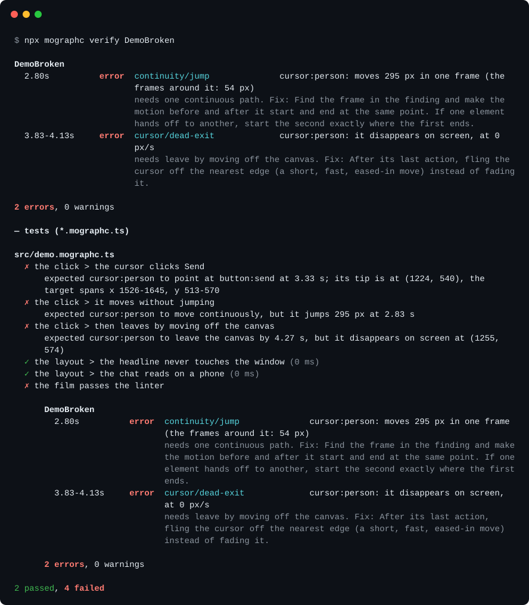

# mographc

mographc is a compiler, linter and test framework for motion graphics made with [Remotion](https://remotion.dev).

mographc renders every frame of a Remotion film and measures every element on every frame: its position, size, opacity, stretch and text. Because a Remotion film is code that renders to the DOM, these measurements are exact, and mographc can check a film in the same three ways that code is usually checked:

- `mographc check` works like `tsc`. It reports what is broken: elements that teleport, flicker, text that is cut off or drawn over other text, images that fail to load, fonts that fall back.
- `mographc lint` works like ESLint. It checks the film against rules about good motion, such as easing, pacing, staging and legibility. It has a flat config file, presets, plugins, per-rule options and ignores written next to the code.
- `mographc test` works like Vitest. You write down what the film is meant to do, for example "the cursor clicks _Send_ at 4.2 s", and mographc checks it.

Each finding reports what was measured, what the rule requires and how to fix it. That way a coding agent making a video can fix problems itself, without a person watching the film and describing what's wrong.

This is the output for the broken version of the [demo film](examples/demo) in this repository, which has three bugs in it:



<details>
<summary>The same output as text</summary>

<!-- verify-output:start -->

```
$ npx mographc verify DemoBroken

DemoBroken
  2.80s          error  continuity/jump              cursor:person: moves 295 px in one frame (the
                        frames around it: 54 px)
                        needs one continuous path. Fix: Find the frame in the finding and make the
                        motion before and after it start and end at the same point. If one element
                        hands off to another, start the second exactly where the first ends.
  3.83-4.13s     error  cursor/dead-exit             cursor:person: it disappears on screen, at 0
                        px/s
                        needs leave by moving off the canvas. Fix: After its last action, fling the
                        cursor off the nearest edge (a short, fast, eased-in move) instead of fading
                        it.

2 errors, 0 warnings

— tests (*.mographc.ts)

src/demo.mographc.ts
  ✗ the click > the cursor clicks Send
      expected cursor:person to point at button:send at 3.33 s; its tip is at (1224, 540), the
      target spans x 1526-1645, y 513-570
  ✗ the click > it moves without jumping
      expected cursor:person to move continuously, but it jumps 295 px at 2.83 s
  ✗ the click > then leaves by moving off the canvas
      expected cursor:person to leave the canvas by 4.27 s, but it disappears on screen at (1255,
      574)
  ✓ the layout > the headline never touches the window (0 ms)
  ✓ the layout > the chat reads on a phone (0 ms)
  ✗ the film passes the linter

      DemoBroken
        2.80s          error  continuity/jump              cursor:person: moves 295 px in one frame
                              (the frames around it: 54 px)
                              needs one continuous path. Fix: Find the frame in the finding and make
                              the motion before and after it start and end at the same point. If one
                              element hands off to another, start the second exactly where the first
                              ends.
        3.83-4.13s     error  cursor/dead-exit             cursor:person: it disappears on screen,
                              at 0 px/s
                              needs leave by moving off the canvas. Fix: After its last action,
                              fling the cursor off the nearest edge (a short, fast, eased-in move)
                              instead of fading it.

      2 errors, 0 warnings

2 passed, 4 failed
```

<!-- verify-output:end -->

</details>

## Getting started

In a Remotion project:

```bash
npm i -D mographc
npx mographc init      # writes mographc.config.ts and an example test
npx mographc verify    # runs the compiler, the linter and the tests; exits 1 on any error
```

mographc needs Node 22.13 or later. Bun users can run it with `bunx mographc`.

You don't need any other setup, because mographc bundles the project with its own `remotion.config.ts` (so Tailwind and custom webpack settings still apply), wraps every composition in a probe, and steps through every frame without taking screenshots. The result is cached until the project's sources change.

mographc uses the project's own copy of Remotion rather than bringing its own, so there is only one version of Remotion in the project and it always matches.

## The three tools

| Command          | Similar to | What it checks                                                                                                                                                                      | Setup                         |
| ---------------- | ---------- | ----------------------------------------------------------------------------------------------------------------------------------------------------------------------------------- | ----------------------------- |
| `mographc check` | `tsc`      | Whether anything is broken: teleports, flicker, text cut off or drawn over other text, missing images, fallback fonts.                                                              | none                          |
| `mographc lint`  | ESLint     | Whether the motion follows the rules: easing strength by move length, squash and stretch, staging, spacing, legibility, pacing, attention, and regressions against an approved cut. | optional `mographc.config.ts` |
| `mographc test`  | Vitest     | Whether the film does what you meant: the cursor clicks _Send_ at 4.2 s, the headline never touches the product.                                                                    | `*.mographc.ts` files         |

`mographc verify` runs all three. `mographc rules` lists every rule, and `mographc explain <rule>` prints what a rule checks, why it matters and how to fix a finding. `mographc help` lists every command and option.

## Naming elements with `data-motion`

Findings and tests are much easier to read when the film's subjects have names:

```tsx
<div data-motion="window:pr">…</div>
<div data-motion="cursor:agent">…<div data-motion-tip style={{ position: "absolute", left: 3, top: 2 }} /></div>
<button data-motion="button:send">Send</button>
```

- **The part before the colon is the role.** It decides which rules apply. The roles are `cursor`, `window`/`card`/`panel` (surfaces), `button`, `headline`/`title`, `logo`, or anything else.
- **The part after the colon is the name.** Elements without a tag are still checked. mographc identifies them by their structure and by following them from frame to frame, and infers their role: large free-standing text is a headline, a painted box is a surface, and a small glyph that travels and stretches is a cursor.
- **`data-motion-tip`** marks a pointer's hotspot, so that `toPointAt` can check exactly where a click lands.

## Configuring the linter

`mographc.config.ts` is a flat config, in the same style as ESLint's. It is an array of blocks applied in order. A preset is an ordinary block, so later blocks can override any of its settings:

```ts
import { defineConfig, recommended } from "mographc";
import { acme } from "./presets/acme";
import { logoClearspace } from "./rules/logo-clearspace";

export default defineConfig([
  recommended, // general motion principles
  acme, // your team's brand preset: colours, fonts, no shadows
  { plugins: [logoClearspace], rules: { "acme/logo-clearspace": "error" } },
  {
    rules: {
      "easing/weak-out": ["error", { long: 0.45 }],
      "pace/text-hold": "off",
    },
  },
  { compositions: ["Teaser"], rules: { "cursor/dead-exit": "off" } },
  {
    between: [9.5, 13],
    rules: { "staging/no-padding": "off" },
    reason: "the page is zoomed in by request",
  },
]);
```

The config can also be `.mts`, `.js` or `.mjs`. TypeScript configs are loaded with [jiti](https://github.com/unjs/jiti), the same way ESLint loads `eslint.config.ts`, so nothing needs to be compiled first.

A block with `between` turns a rule off (or changes its severity) for a stretch of time, and must give a `reason`. To accept a single finding, put the reason on the element where it happens:

```tsx
<div data-motion="cursor:agent" data-motion-ignore="cursor/dead-exit: it turns into the share button">
```

Accepted findings are still printed, marked `ok` with their reason, but they never fail the run. They stay visible so that when a reason stops being true, someone reading the output can notice and remove the suppression.

## Writing a rule

Built-in rules and your own rules use the same API. A rule reads the **film model**: every element across every frame, with its identity, role, box, visible area, opacity, stretch and text, plus helpers for moves, speeds and headlines.

```ts
import { defineRule, px, type Box } from "mographc";

const grow = (b: Box, by: number): Box => [
  b[0] - by,
  b[1] - by,
  b[2] + 2 * by,
  b[3] + 2 * by,
];
const overlaps = (a: Box, b: Box) =>
  a[0] < b[0] + b[2] &&
  b[0] < a[0] + a[2] &&
  a[1] < b[1] + b[3] &&
  b[1] < a[1] + a[3];

export const logoClearspace = defineRule({
  id: "acme/logo-clearspace",
  kind: "lint",
  severity: "error",
  options: { ratio: 1 },
  docs: {
    summary: "The logo keeps clear space equal to its height on every side.",
    why: "The brand guide asks for clear space around the logo, because crowding makes it harder to recognise.",
    fix: "Move nearby elements away from the logo, or scale the logo down.",
  },
  check({ film, options, report }) {
    for (const logo of film.find({ role: "logo" }))
      for (const f of logo.frames) {
        const box = logo.at(f)!.visible;
        const pad = Math.max(box[3] * options.ratio, px(film, 8));
        const crowded = film.elements.find(
          (e) =>
            e !== logo && e.at(f) && overlaps(e.at(f)!.visible, grow(box, pad)),
        );
        if (crowded)
          report({
            element: logo,
            frames: [f, f],
            measured: `${crowded.label} is within ${pad.toFixed(0)} px`,
            need: `${pad.toFixed(0)} px of clear space`,
          });
      }
  },
});
```

`px(film, n)` converts a size measured at 1080p into the film's own pixels, and `area(box)` gives a box's area. The built-in rules use both so that their thresholds hold at any resolution.

[`examples/brand-preset`](examples/brand-preset) is a complete brand preset (colours, typeface, type weight, no shadows) written only with the public API. Copy it to start your own.

Other rules a team might write:

- only the brand's fonts are used
- the call to action stays on screen for at least 2 s
- a legal disclaimer is visible for at least 3 s
- nothing sits under TikTok's interface overlays
- the trademark symbol appears on the first mention
- text meets a minimum contrast ratio
- there are no more than three flashes a second

## Writing tests

Test files end in `.mographc.ts` (or `.tsx`, `.js`). mographc runs them itself on Node, with the same `describe`, `test` and `expect` API as Vitest and Jest, so you don't need to install a test runner.

```ts
import { describe, expect, loadFilm, test } from "mographc/test";
const film = await loadFilm("Launch");

describe("beat 2", () => {
  test("the agent clicks Send", () =>
    expect(film.get("cursor:agent")).toPointAt(film.get("button:send"), {
      at: 4.2,
    }));
  test("then flings off", () =>
    expect(film.get("cursor:agent")).toLeaveCanvas({ by: 5 }));
  test("the chat reads on a phone", () =>
    expect(film.get("window:chat")).toHaveTextAtLeast(18, { during: [3, 5] }));
});
test("the film lints clean", async () => {
  await expect(film).toPassLint();
});
```

The file name doesn't end in `.test.ts` on purpose. Vitest, Jest and Bun pick up every `*.test.ts` file by default, and they would try to run film tests that need mographc's runner.

Film matchers:

| Kind       | Matchers                                             |
| ---------- | ---------------------------------------------------- |
| Visibility | `toBeVisible`, `toBeHidden`                          |
| Position   | `toPointAt`, `toLandAt`, `toOverlap`, `toStayInside` |
| Text       | `toHaveTextAtLeast`, `toHold`                        |
| Motion     | `toMoveContinuously`, `toEaseOut`, `toLeaveCanvas`   |
| Timing     | `toAppearAt`, `toPrecede`                            |
| Attention  | `toBeRead`, `toBeTheFocus`                           |
| Whole film | `toPassLint`                                         |

`expect` also has the common general matchers (`toBe`, `toEqual`, `toBeTruthy`, `toBeGreaterThan`, `toContain`, `toMatch` and others), every matcher supports `.not`, and `expect.extend` adds your own. The [testing guide](skills/mographc/references/testing.md) explains what to test in each beat.

## Baselines

When a person approves a cut, `mographc baseline save` stores its film in `.mographc/baselines/`. From then on, `lint` also reports regressions against it: content removed from a beat, a weaker ease-out on the same move, a smaller cursor, or less stretch. Commit the baseline so everyone on the project compares against the same approved cut.

## How it works

1. **Bundling.** mographc bundles the project with its own Remotion config and swaps Remotion's `<Composition>` for one that wraps every composition in a probe.
2. **Probing.** Every frame is rendered without taking screenshots. After each frame settles, the probe reads each element from the DOM: its box (text is measured by its glyphs), the part of it that is visible, its opacity, the stretch of its transforms, its text, font size, colours and shadows, and its `data-motion` tags.
3. **The film model.** Elements are tracked from frame to frame, by their tag when they have one, and otherwise by the continuity of their structure, position and size. mographc then works out roles, moves and headlines.
4. **The simulated viewer.** mographc estimates where a viewer's eye goes on each frame (to what just appeared or moved, or the next unread line) and how much text they manage to read at 3.5 words a second.
5. **The checks.** `check` runs the compiler rules, `lint` runs the configured rules with suppressions and the baseline, and `test` runs your files.

We read the DOM rather than analysing pixels because the DOM gives exact boxes, text and identities, which makes each finding precise enough to name the element and the frame. Measurements are in seconds and pixels per second, and thresholds scale with the canvas, so the rules hold at any frame rate and resolution.

## Using it with an agent

[`skills/mographc`](skills/mographc/SKILL.md) is an agent skill for planning, building and verifying a Remotion film with mographc. It also ships inside the npm package, in `node_modules/mographc/skills/mographc`. It includes references on craft (story, staging, attention), recipes for motion that passes the rules, and how to write tests.

## The demo film

[`examples/demo`](examples/demo) is a short Remotion film with a window, a cursor and a headline. Its `Demo` composition passes every check, and `DemoBroken` is the same film with three bugs added, so you can see what mographc reports.

## Contributing

See [CONTRIBUTING.md](CONTRIBUTING.md). mographc is released under the [MIT license](LICENSE).
